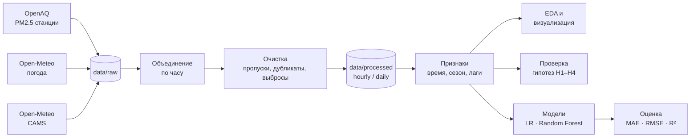

<p align="center">
  
</p>

<h1 align="center">Смог в Алматы: анализ и прогнозирование загрязнения воздуха PM2.5</h1>

<p align="center">
  Итоговый проект по дисциплине <b>Introduction to Data Science</b> · Международный университет информационных технологий (IITU), Алматы
</p>

<p align="center">
  
  
  
  
  
  
  <a href="LICENSE"></a>
</p>

<p align="center">
  <a href="#-о-проекте">О проекте</a> ·
  <a href="#-данные">Данные</a> ·
  <a href="#-как-устроен-анализ">Пайплайн</a> ·
  <a href="#-быстрый-старт">Быстрый старт</a> ·
  <a href="#-план-работ">План</a> ·
  <a href="#-результаты">Результаты</a> ·
  <a href="#-команда">Команда</a>
</p>

---

## 📌 О проекте

Алматы зимой регулярно попадает в число городов с самым грязным воздухом в Центральной Азии. Город лежит в котловине у гор: в безветренные морозные дни загрязнение от отопления и транспорта не рассеивается и висит над городом. Мелкие частицы **PM2.5** проникают глубоко в лёгкие; рекомендация ВОЗ (2021) — не более **15 µg/m³** в среднем за сутки.

**Исследовательский вопрос**

> Как сезон, время суток и погодные условия (температура, ветер, влажность, осадки, давление) влияют на концентрацию PM2.5 в Алматы, и можно ли по метеоданным прогнозировать уровень загрязнения?

**Гипотезы**

| | Гипотеза | Как проверяем | Статус |
|---|---|---|:---:|
| **H1** | Зимой (отопительный сезон) PM2.5 значительно выше, чем летом | Mann–Whitney U | ⏳ |
| **H2** | При слабом ветре и низкой температуре загрязнение выше | корреляция Спирмена, графики | ⏳ |
| **H3** | Есть выраженные вечерние и ночные пики | тепловая карта «час × месяц» | ⏳ |
| **H4** | Модельные данные CAMS систематически отличаются от измерений станции | сравнение рядов, ошибки | ⏳ |

## 🗂 Данные

Готовый датасет не используем — **собираем собственный** из трёх открытых API и объединяем по времени.

| Источник | Что берём | Тип | Доступ |
|---|---|---|---|
| [OpenAQ API v3](https://explore.openaq.org/locations/8876) — станция Almaty (ID 8876, AirNow) | PM2.5, почасово, с 2020 г. | измерения эталонной станции | бесплатно, API-ключ |
| [Open-Meteo Historical Weather](https://open-meteo.com/en/docs/historical-weather-api) | температура, ветер, влажность, осадки, давление | архив погоды (реанализ) | бесплатно, без ключа |
| [Open-Meteo Air Quality](https://open-meteo.com/en/docs/air-quality-api) | модельный PM2.5 (Copernicus CAMS) | модельные данные | бесплатно, без ключа |

Сырые ответы API сохраняются в `data/raw/` и **не изменяются** — весь анализ воспроизводится от них.

## 🔬 Как устроен анализ



| Этап | Ноутбук / модуль | Методы |
|---|---|---|
| Сбор | `notebooks/01_collect.ipynb`, `src/collect.py` | `requests`, пагинация, учёт лимитов API |
| Очистка и объединение | `notebooks/02_clean.ipynb`, `src/clean.py` | UTC → Asia/Almaty, `merge(validate=…)`, интерполяция коротких пропусков |
| Признаки | `src/features.py` | час, день недели, месяц, сезон, отопительный сезон, лаги PM2.5 |
| EDA | `notebooks/03_eda.ipynb` | распределения, сезонность, суточный цикл, корреляции |
| Модели | `notebooks/04_model.ipynb` | Linear Regression (baseline), Random Forest, сравнение с наивным прогнозом |

**Методологические принципы**

- Разбиение train/test — **только по времени**, без перемешивания: модель не должна «видеть будущее».
- Любая модель сравнивается с **наивным прогнозом** («следующий час = текущий»).
- Реальные пики смога **не удаляются** как выбросы — удаляются только физически невозможные значения.
- Каждый шаг очистки — функция с проверками и тестами.

## 📁 Структура репозитория

```
smog-almaty/
├── assets/              оформление README
├── data/
│   ├── raw/             сырые ответы API (не изменяются)
│   └── processed/       очищенные таблицы hourly.csv, daily.csv
├── figures/             графики для презентации
├── notebooks/           01_collect → 02_clean → 03_eda → 04_model
├── scripts/check.sh     проверка проекта: ruff + pytest
├── src/                 функции сбора, очистки и признаков
├── tests/               тесты для src/
├── .env.example         шаблон для API-ключа
├── pyproject.toml       настройки ruff и pytest
└── requirements.txt     зависимости
```

## 🚀 Быстрый старт

**Требования:** Python 3.11+, Git.

```bash
git clone https://github.com/nurbolatdev/smog-almaty.git
cd smog-almaty

python3 -m venv .venv
source .venv/bin/activate          # Windows: .venv\Scripts\activate
pip install -r requirements.txt
```

**Ключ OpenAQ** нужен только для повторной выгрузки данных — готовые сырые данные лежат в `data/raw/`.

1. Зарегистрируйтесь на [explore.openaq.org/register](https://explore.openaq.org/register) (бесплатно).
2. `cp .env.example .env` и впишите ключ в `OPENAQ_API_KEY=`.

**Запуск анализа:** `jupyter notebook` → откройте ноутбуки по порядку и выполните сверху вниз.

**Проверка проекта:**

```bash
bash scripts/check.sh               # → GATE PASS
```

## 🗺 План работ

- [x] **0.** Подготовка окружения и структуры репозитория
- [ ] **1.** Сбор данных: OpenAQ, Open-Meteo Weather, Open-Meteo CAMS
- [ ] **2.** Очистка данных
- [ ] **3.** Объединение и признаки
- [ ] **4.** EDA и визуализация
- [ ] **5.** Проверка гипотез H1–H4
- [ ] **6.** Моделирование
- [ ] **7.** Интерпретация результатов
- [ ] **8.** README и воспроизводимость
- [ ] **9.** Презентация и защита

## 📊 Результаты

> Раздел заполняется по мере выполнения кода. Все числа берутся только из выполненных ноутбуков.

| Показатель | Значение | Источник |
|---|---|---|
| Средний PM2.5 зимой / летом | — | `03_eda.ipynb` |
| Доля дней выше нормы ВОЗ (15 µg/m³) | — | `03_eda.ipynb` |
| Пиковые часы | — | `03_eda.ipynb` |
| Linear Regression: MAE / RMSE / R² | — | `04_model.ipynb` |
| Random Forest: MAE / RMSE / R² | — | `04_model.ipynb` |

## ⚠️ Ограничения

- Одна станция на весь город — не отражает различия между районами.
- Нет прямых данных об источниках выбросов (ТЭЦ, частный сектор, трафик) и о температурных инверсиях.
- Погода — из реанализа, а не с метеостанции рядом с датчиком; CAMS имеет грубое пространственное разрешение.
- Корреляция не означает причинность.

## 👥 Команда

| Участник | Зона ответственности |
|---|---|
| **Джумадилов Нурболат** · [@nurbolatdev](https://github.com/nurbolatdev) | сбор данных OpenAQ, EDA и визуализация, проверка гипотез, моделирование, интерпретация, презентация |
| **Аскар Багдаулет** | окружение, сбор Open-Meteo, очистка, объединение и признаки, гипотеза H4, README и воспроизводимость |

Как мы работаем с веткой, коммитами и PR — в [CONTRIBUTING.md](CONTRIBUTING.md).

## 📄 Лицензия и источники

- Код — под лицензией [MIT](LICENSE).
- Данные о качестве воздуха — [OpenAQ](https://openaq.org) (условия использования OpenAQ; первоисточник — AirNow, U.S. Department of State).
- [Weather data by Open-Meteo.com](https://open-meteo.com/) — [CC BY 4.0](https://creativecommons.org/licenses/by/4.0/).
- Модельные данные о качестве воздуха — Copernicus Atmosphere Monitoring Service (CAMS) через Open-Meteo.
- Норматив PM2.5 — [WHO Global Air Quality Guidelines, 2021](https://www.who.int/publications/i/item/9789240034228).
