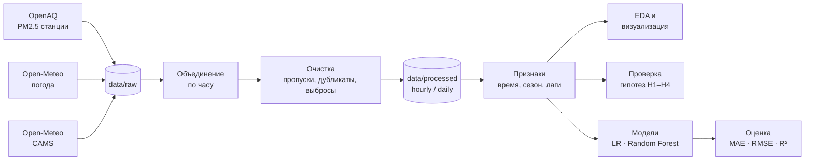
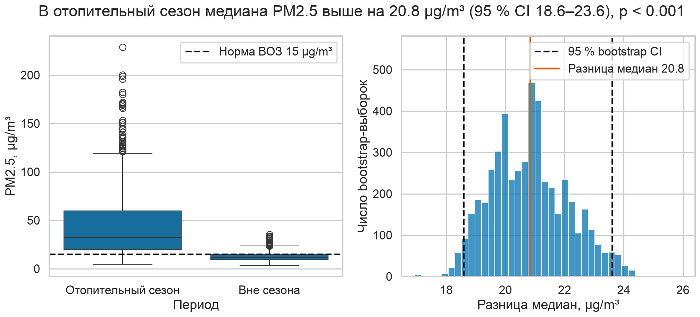
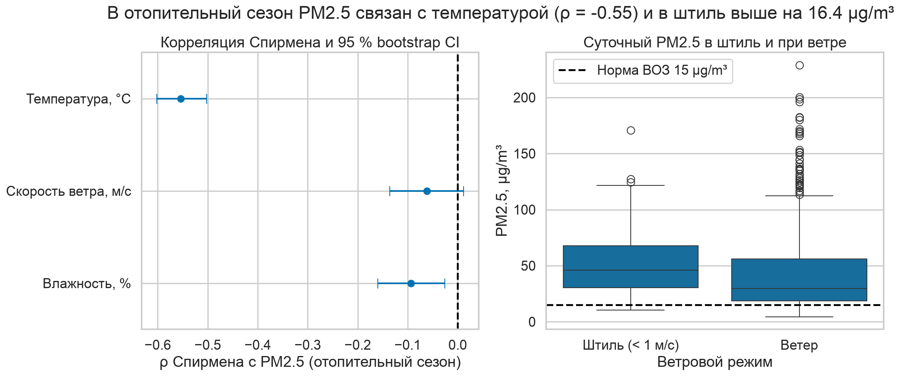
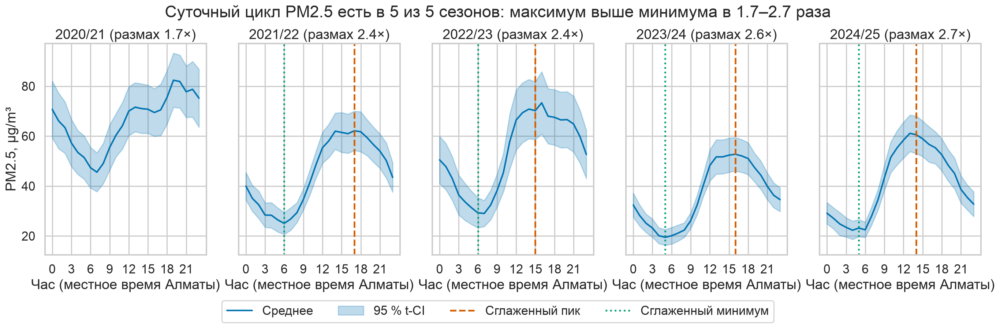
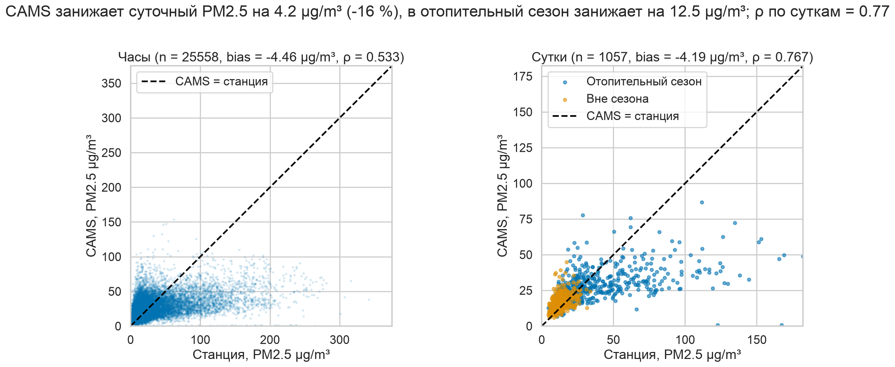
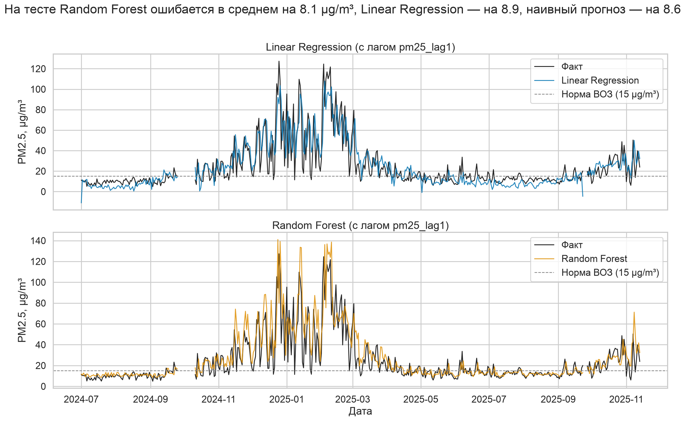

<p align="center">
  
</p>

<h1 align="center">Смог в Алматы: анализ и прогнозирование загрязнения воздуха PM2.5</h1>

<p align="center">
  Итоговый проект по дисциплине <b>Introduction to Data Science</b> · Международный университет информационных технологий (IITU), Алматы
</p>

<p align="center">
  
  
  
  
  
  
  <a href="LICENSE"></a>
</p>

<p align="center">
  <a href="#-о-проекте">О проекте</a> ·
  <a href="#-данные">Данные</a> ·
  <a href="#-как-устроен-анализ">Пайплайн</a> ·
  <a href="#-быстрый-старт">Быстрый старт</a> ·
  <a href="#-план-работ">План</a> ·
  <a href="#-результаты">Результаты</a> ·
  <a href="#-команда">Команда</a>
</p>

---

## 📌 О проекте

Алматы зимой регулярно попадает в число городов с самым грязным воздухом в Центральной Азии. Город лежит в котловине у гор: в безветренные морозные дни загрязнение от отопления и транспорта не рассеивается и висит над городом. Мелкие частицы **PM2.5** проникают глубоко в лёгкие; рекомендация ВОЗ (2021) — не более **15 µg/m³** в среднем за сутки.

**Исследовательский вопрос**

> Как сезон, время суток и погодные условия (температура, ветер, влажность, осадки, давление) влияют на концентрацию PM2.5 в Алматы, и можно ли по метеоданным прогнозировать уровень загрязнения?

**Гипотезы**

| | Гипотеза | Как проверяем | Статус |
|---|---|---|:---:|
| **H1** | Зимой (отопительный сезон) PM2.5 значительно выше, чем летом | Welch t, Mann–Whitney U | ✅ подтверждена |
| **H2** | При слабом ветре и низкой температуре загрязнение выше | Спирмен + Mann–Whitney (штиль против ветра) | частично |
| **H3** | Есть выраженные вечерние и ночные пики | профиль по часам по сезонам, 95 % CI | частично |
| **H4** | Модельные данные CAMS систематически отличаются от измерений станции | bias и MAE по суткам, 95 % bootstrap-CI | ✅ подтверждена с оговоркой |

## 🗂 Данные

Готовый датасет не используем — **собираем собственный** из трёх открытых API и объединяем по времени.

| Источник | Что берём | Тип | Доступ |
|---|---|---|---|
| [OpenAQ API v3](https://explore.openaq.org/locations/8876) — станция Almaty (ID 8876, AirNow) | PM2.5, почасово, с 2020 г. | измерения эталонной станции | бесплатно, API-ключ |
| [Open-Meteo Historical Weather](https://open-meteo.com/en/docs/historical-weather-api) | температура, ветер, влажность, осадки, давление | архив погоды (реанализ) | бесплатно, без ключа |
| [Open-Meteo Air Quality](https://open-meteo.com/en/docs/air-quality-api) | модельный PM2.5 (Copernicus CAMS) | модельные данные | бесплатно, без ключа |

Сырые ответы API сохраняются в `data/raw/` и **не изменяются** — весь анализ воспроизводится от них.

## 🔬 Как устроен анализ



| Этап | Ноутбук / модуль | Методы |
|---|---|---|
| Сбор | `notebooks/01_collect.ipynb`, `src/collect.py` | `requests`, пагинация, учёт лимитов API |
| Очистка и объединение | `notebooks/02_clean.ipynb`, `src/clean.py` | UTC → Asia/Almaty, `merge(validate=…)`, интерполяция коротких пропусков |
| Признаки | `src/features.py` | час, день недели, месяц, сезон, отопительный сезон, лаги PM2.5 |
| EDA | `notebooks/03_eda.ipynb` | распределения, сезонность, суточный цикл, корреляции |
| Модели | `notebooks/04_model.ipynb` | Linear Regression (baseline), Random Forest, сравнение с наивным прогнозом |

**Методологические принципы**

- Разбиение train/test — **только по времени**, без перемешивания: модель не должна «видеть будущее».
- Любая модель сравнивается с **наивным прогнозом** («завтра = сегодня»: суточное среднее вчера).
- Реальные пики смога **не удаляются** как выбросы — удаляются только физически невозможные значения.
- Каждый шаг очистки — функция с проверками и тестами.

## 📁 Структура репозитория

```
smog-almaty/
├── assets/              оформление README
├── data/
│   ├── raw/             сырые ответы API (не изменяются)
│   └── processed/       очищенные таблицы hourly.csv, daily.csv
├── figures/             графики для презентации
├── notebooks/           01_collect → 02_clean → 03_eda → 04_model
├── scripts/check.sh     проверка проекта: ruff + pytest
├── src/                 функции сбора, очистки и признаков
├── tests/               тесты для src/
├── .env.example         шаблон для API-ключа
├── pyproject.toml       настройки ruff и pytest
└── requirements.txt     зависимости
```

## 🚀 Быстрый старт

**Требования:** Python 3.11+, Git.

```bash
git clone https://github.com/nurbolatdev/smog-almaty.git
cd smog-almaty

python3 -m venv .venv
source .venv/bin/activate          # Windows: .venv\Scripts\activate
pip install -r requirements.txt
```

**Ключ OpenAQ** нужен только для повторной выгрузки данных — готовые сырые данные лежат в `data/raw/`.

1. Зарегистрируйтесь на [explore.openaq.org/register](https://explore.openaq.org/register) (бесплатно).
2. `cp .env.example .env` и впишите ключ в `OPENAQ_API_KEY=`.

**Запуск анализа:** `jupyter notebook` → откройте ноутбуки по порядку и выполните сверху вниз.

**Проверка проекта:**

```bash
bash scripts/check.sh               # → GATE PASS
```

## 🗺 План работ

- [x] **0.** Подготовка окружения и структуры репозитория
- [ ] **1.** Сбор данных: OpenAQ, Open-Meteo Weather, Open-Meteo CAMS
- [ ] **2.** Очистка данных
- [ ] **3.** Объединение и признаки
- [ ] **4.** EDA и визуализация
- [ ] **5.** Проверка гипотез H1–H4
- [ ] **6.** Моделирование
- [ ] **7.** Интерпретация результатов
- [ ] **8.** README и воспроизводимость
- [ ] **9.** Презентация и защита

## 📊 Результаты

> Все числа ниже взяты из выводов выполненных ноутбуков (у каждой строки указан источник). **Факт** — то, что посчитано по данным; **Интерпретация** — наше объяснение, не доказанное данными.

**Ответ на исследовательский вопрос.** Сильнее всего уровень PM2.5 связан с сезоном: в отопительный сезон медиана суточного PM2.5 выше на 20.833 µg/m³ (95 % CI [18.583, 23.604]); из погодных факторов сильнее всего связана температура (ρ = -0.554 в отопительный сезон), с ветром связь слабая, а суточный цикл есть, но пик приходится на день (14–17 ч), а не на вечер. Прогноз суточного PM2.5 по погоде и вчерашнему значению ошибается в среднем на 8.097 µg/m³ (Random Forest), но доказать, что он точнее правила «завтра как сегодня» (8.592 µg/m³), на нашем тестовом периоде не удалось.

### Ключевые цифры

| Показатель | Значение | Источник |
|---|---|---|
| Объём данных станции | 37 823 из 49 075 часов; 1 534 суток с валидным средним (≥ 18 ч) из 2 044 полных | `01_collect.ipynb`, `02_features.ipynb` |
| Суточный PM2.5 за весь период | медиана 16.871711 µg/m³, среднее 29.065487 µg/m³ | `03_eda.ipynb`, шаг 3 |
| Зима и лето (медиана / среднее) | зима 57.291667 / 65.285704 µg/m³; лето 10.333333 / 10.775799 µg/m³ | `03_eda.ipynb`, шаг 3 |
| Дни выше нормы ВОЗ (15 µg/m³) | 55.1 % (845 из 1 534 суток); худший месяц — декабрь 96.2 % (127/132), лучший — август 3.8 % (5/132) | `03_eda.ipynb`, шаг 7 |
| Пиковые часы (при допущении, что метки станции — UTC) | тепловая карта: январь, 15:00 (95.3 µg/m³); профиль: сезон пик 14:00 (61.1), мин. 6:00 (27.7), вне сезона пик 20:00 (15.9) | `03_eda.ipynb`, шаги 8–9 |
| Погодный фактор с самой сильной связью | температура: ρ = -0.72 за год (связь смешана с сезоном) и ρ = -0.55 в отопительный сезон (-0.554 в H2) | `03_eda.ipynb`, шаги 10–11, 21 |

### Гипотезы

| | Гипотеза (кратко) | Факт: n и эффект (95 % CI) | Интерпретация | Вывод | Источник |
|---|---|---|---|---|---|
| **H1** | Отопительный сезон выше остального года | 771 против 763 суток; медианы 32.208 и 11.375 µg/m³; Δ медиан 20.833 [18.583, 23.604]; Welch t = 25.110, U = 533 370 (p < 0.001), prob_superiority 0.907; прореживание (k = 14): Δ 13.23–29.87, max p = 2.49e-10 (MW) / 2.75e-06 (Welch) | Различие большое и устойчиво к прореживанию; причину (отопление или погода) тесты не устанавливают | ✅ подтверждена | `03_eda.ipynb`, шаги 19–20 |
| **H2** | Слабый ветер и холод связаны с ростом PM2.5 | Сезон (n = 771): ρ температура -0.554 [-0.602, -0.502] (p < 0.001), ветер -0.062 [-0.136, 0.012] (p = 0.087), влажность -0.094 (p = 0.009); штиль (128) против ветра (643): Δ медиан 16.406 [10.198, 25.327], prob_superiority 0.638 (p < 0.001) | Температура и влажность проходят α/m = 0.01, ветер по ρ — нет; штиль выше, но связь с ветром не монотонна и штиль холоднее — факторы не разделить | частично | `03_eda.ipynb`, шаг 21 |
| **H3** | Выраженные вечерние и ночные пики | Суточный цикл в 5 из 5 сезонов (95 % CI пика и минимума не пересекаются); `peak_to_low` 1.70–2.66; пики 17 / 15 / 16 / 14 ч (2021/22–2024/25, допущение UTC) | Цикл есть, но пик днём (14–17 ч), а не вечером/ночью — исходная формулировка не подтвердилась; причину формы не утверждаем | частично | `03_eda.ipynb`, шаг 22 |
| **H4** | CAMS систематически отличается от станции | 1 057 суток (502 в сезон, 555 вне): bias -4.192 [-5.454, -2.984] (-16.125 %), MAE 11.243 [10.189, 12.346]; сезон -12.491 [-14.856, -10.144], вне +3.314 [2.889, 3.755]; ρ = 0.767 [0.737, 0.794] (часы 0.533); прореживание: CI без 0 в 9 из 14 сдвигов | CAMS занижает зимой и завышает вне сезона, колебания повторяет лучше уровня; устойчивость частичная (9 из 14); причину не устанавливаем | ✅ подтверждена с оговоркой | `05_cams_vs_station.ipynb`, шаги 4–7 |
| **χ²** | Сезон связан с долей дней > нормы ВОЗ | n = 1 534; χ² = 608.07 (dof = 3, p < 0.001), V = 0.630; доля > 15 µg/m³: зима 96.07 %, лето 8.26 % | Сильная связь доли превышений нормы ВОЗ с сезоном; причину тест не устанавливает | ✅ связь есть | `03_eda.ipynb`, шаг 23 |

- Уровень значимости: α = 0.05 для H1; подтверждающие тесты (H2, χ²) сравниваются с поправкой Бонферрони α/m = 0.01.
- Соседние сутки зависимы — устойчивость проверена прореживанием с шагом k = 14 для H1 и H4 (подробности — в разделе «Ограничения»).


*В отопительный сезон медиана PM2.5 выше на 20.8 µg/m³ (95 % CI 18.6–23.6), p < 0.001*


*В отопительный сезон PM2.5 связан с температурой (ρ = -0.55) и в штиль выше на 16.4 µg/m³*


*Суточный цикл PM2.5 есть в 5 из 5 сезонов: максимум выше минимума в 1.7–2.7 раза*


*CAMS занижает суточный PM2.5 на 4.2 µg/m³ (-16 %), в отопительный сезон занижает на 12.5 µg/m³; ρ по суткам = 0.77*

### Модели прогноза

Цель — суточное среднее PM2.5 (`pm25_mean`). Признаки: вчерашнее значение (`pm25_lag1`), фактическая погода того же дня (температура, ветер, влажность, осадки, давление) и календарные флаги (`heating_season`, `is_weekend`). Разбиение по времени без перемешивания: `train` — 931 сутки (2020-04-11 … 2024-06-30), `test` — 483 суток (2024-07-01 … 2025-11-13).

| Прогноз | MAE, µg/m³ | RMSE, µg/m³ | R² | MAE − наивный, 95 % CI |
|---|---:|---:|---:|---|
| Наивный («завтра = сегодня») | 8.592 | 14.828 | 0.581 | — |
| Linear Regression | 8.921 | 13.054 | 0.675 | 0.330 [-0.270, 0.910] |
| Random Forest | 8.097 | 13.653 | 0.644 | -0.495 [-1.326, 0.313] |

Источник: `notebooks/04_model.ipynb`, шаги 5–6.

**Факт:**
- У Random Forest MAE ниже наивного (8.097 против 8.592 µg/m³), у Linear Regression — выше (8.921), но 95 % bootstrap-CI разности MAE включают 0 у обеих моделей (`-0.495 [-1.326, 0.313]` и `0.330 [-0.270, 0.910]`); при этом у Linear Regression лучше RMSE (`13.054` против `14.828`) и R² (`0.675` против `0.581`).
- MAE по сезонам: в отопительный сезон (213 суток) — 15.419 (наивный), 13.725 (Linear Regression), 14.583 (Random Forest); вне сезона (270 суток) — 3.206, 5.132 и 2.981 µg/m³ (CI для сезонов не считали).
- Без вчерашнего значения (`pm25_lag1`) обе модели уступают наивному прогнозу — CI разности MAE не включают 0: `4.238 [3.035, 5.364]` (Linear Regression) и `2.173 [0.887, 3.469]` (Random Forest).

**Интерпретация:**
- На этом тестовом периоде превосходство моделей над правилом «завтра как сегодня» не доказано (оба CI разности MAE включают 0).
- По разбору признаков (график 10, `notebooks/04_model.ipynb`, шаг 8) модели опираются прежде всего на вчерашнее значение и температуру — это статистическая связь для прогноза, а не доказательство причины смога.


*На тесте Random Forest ошибается в среднем на 8.1 µg/m³, Linear Regression — на 8.9, наивный прогноз — на 8.6*

Все графики — в `figures/`.

## ⚠️ Ограничения

- Одна станция на весь город — не отражает различия между районами.
- Нет прямых данных об источниках выбросов (ТЭЦ, частный сектор, трафик) и о температурных инверсиях.
- Погода — из реанализа, а не с метеостанции рядом с датчиком; CAMS имеет грубое пространственное разрешение.
- Корреляция не означает причинность.

## 👥 Команда

| Участник | Зона ответственности |
|---|---|
| **Джумадилов Нурболат** · [@nurbolatdev](https://github.com/nurbolatdev) | сбор данных OpenAQ, EDA и визуализация, проверка гипотез, моделирование, интерпретация, презентация |
| **Аскар Багдаулет** | окружение, сбор Open-Meteo, очистка, объединение и признаки, гипотеза H4, README и воспроизводимость |

Как мы работаем с веткой, коммитами и PR — в [CONTRIBUTING.md](CONTRIBUTING.md).

## 📄 Лицензия и источники

- Код — под лицензией [MIT](LICENSE).
- Данные о качестве воздуха — [OpenAQ](https://openaq.org) (условия использования OpenAQ; первоисточник — AirNow, U.S. Department of State).
- [Weather data by Open-Meteo.com](https://open-meteo.com/) — [CC BY 4.0](https://creativecommons.org/licenses/by/4.0/).
- Модельные данные о качестве воздуха — Copernicus Atmosphere Monitoring Service (CAMS) через Open-Meteo.
- Норматив PM2.5 — [WHO Global Air Quality Guidelines, 2021](https://www.who.int/publications/i/item/9789240034228).
